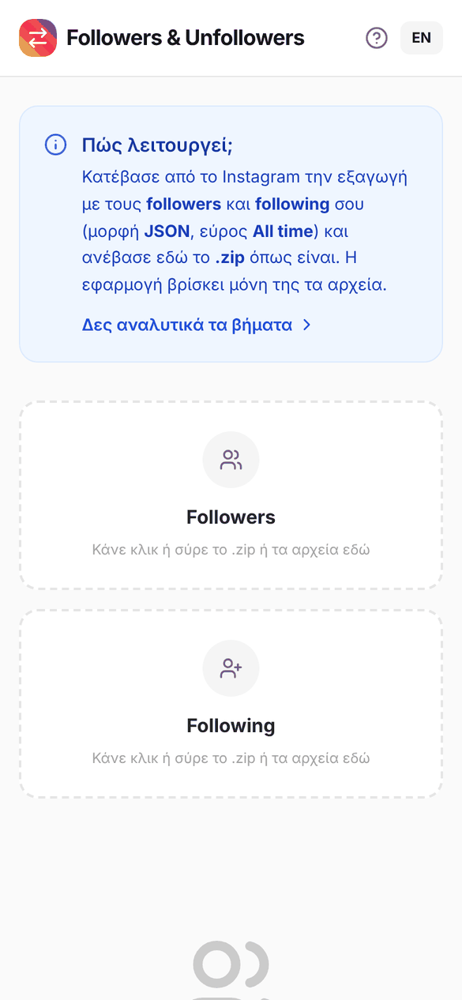
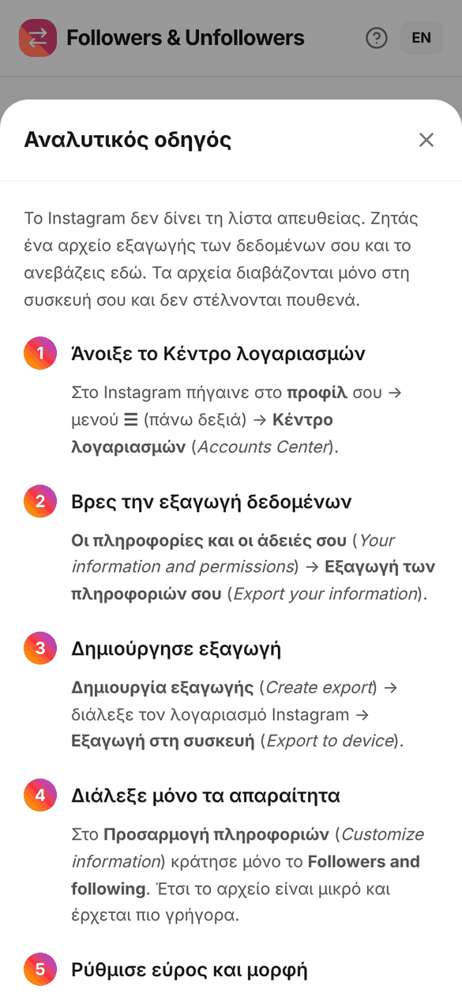
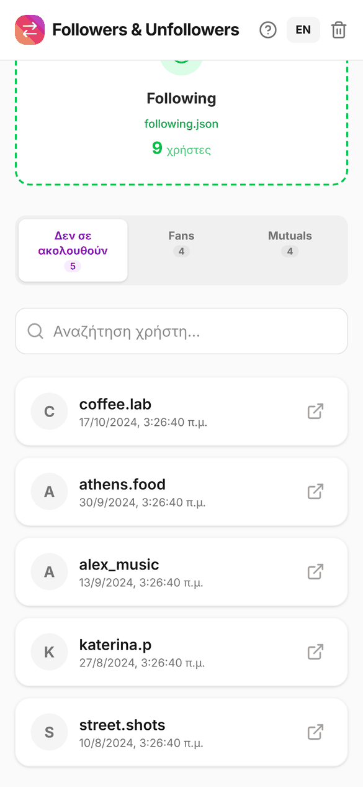

# Followers & Unfollowers

Σύγκρινε τους followers και τους following σου στο Instagram και δες ποιοι δεν σε ακολουθούν πίσω.

**👉 [petrosfs.github.io/Followers-Unfollowers](https://petrosfs.github.io/Followers-Unfollowers/)**

Όλα γίνονται τοπικά στον browser. Τα αρχεία σου δεν ανεβαίνουν πουθενά και δεν χρειάζεται σύνδεση στο Instagram.

Στο κινητό μπορείς να την προσθέσεις στην αρχική οθόνη (Android: μενού του Chrome → *Προσθήκη στην αρχική οθόνη* · iPhone: Safari → Κοινοποίηση → *Προσθήκη στην οθόνη Αφετηρίας*) και ανοίγει σαν εφαρμογή.

<p align="center">
  
  &nbsp;
  
  &nbsp;
  
</p>

## Τι δείχνει

- **Δεν σε ακολουθούν**: τους ακολουθείς, αλλά δεν σε ακολουθούν.
- **Fans**: σε ακολουθούν, αλλά δεν τους ακολουθείς.
- **Mutuals**: ακολουθείτε ο ένας τον άλλον.

Υπάρχει αναζήτηση χρήστη και επιλογή γλώσσας (Ελληνικά / English).

## Πώς παίρνεις τα αρχεία από το Instagram

Μέσα στην εφαρμογή υπάρχει **αναλυτικός οδηγός** με όλα τα βήματα (κουμπί **?** πάνω δεξιά ή «Δες αναλυτικά τα βήματα»). Συνοπτικά:

1. Instagram → **προφίλ** → **☰** → **Κέντρο λογαριασμών** → **Οι πληροφορίες και οι άδειές σου** → **Εξαγωγή των πληροφοριών σου**.
2. **Δημιουργία εξαγωγής** → **Εξαγωγή στη συσκευή**.
3. Κράτησε μόνο το **Followers and following**, με εύρος **All time** και μορφή **JSON**.
4. Όταν η εξαγωγή είναι έτοιμη, κατέβασε το `.zip`.
5. Ανέβασε το `.zip` **όπως είναι** σε οποιοδήποτε πλαίσιο. Η εφαρμογή βρίσκει μόνη της τους followers και τους following.

Εναλλακτικά, ανέβασε χωριστά τα `followers_*.json` στο **Followers** (όλα μαζί αν είναι πολλά) και το `following.json` στο **Following**.

Υποστηρίζονται αρχεία ZIP, JSON, HTML και TXT (ένα username ανά γραμμή).

> Τα ονόματα των μενού μπορεί να διαφέρουν λίγο ανάλογα με την έκδοση του Instagram και τη γλώσσα.

## Εκτέλεση τοπικά

Χρειάζεται [Node.js](https://nodejs.org/).

```bash
npm install
npm run dev
```

Η εφαρμογή ανοίγει στο http://localhost:3000/Followers-Unfollowers/.

Για production build:

```bash
npm run build
npm run preview
```

## Τεχνολογίες

React 19 · TypeScript · Vite · Tailwind CSS · Motion · lucide-react · fflate · vite-plugin-pwa

Κάθε push στο `main` ανεβαίνει αυτόματα στο GitHub Pages μέσω GitHub Actions.

## Άδεια

[MIT](LICENSE)
